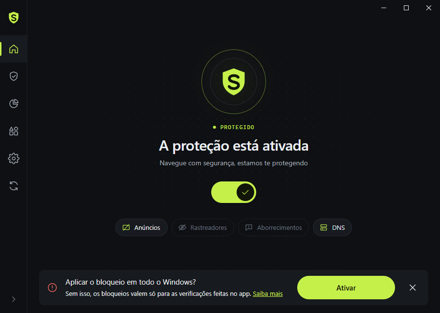

<p align="center">
  
</p>

<h1 align="center">StrickerGuard</h1>

<p align="center">Bloqueador de anúncios, rastreadores e sites perigosos para Windows.</p>

<p align="center">
  
</p>

StrickerGuard é um app de bandeja para Windows feito com Tauri 2 (Rust) e TypeScript + Tailwind.
Ele baixa listas de filtros públicas, avalia as regras localmente e, se você permitir, aplica o
bloqueio no Windows inteiro pelo arquivo `hosts` e pela troca do servidor DNS.

## Recursos

- **Bloqueio de anúncios**, **proteção contra rastreamento**, **bloqueio de aborrecimentos**
  (avisos de cookies, pop-ups, widgets) e **segurança da navegação** (phishing e malware).
- **Proteção de DNS**: escolha de servidor DNS (com teste de latência) e regras de DNS próprias.
- **Controle parental** com lista de bloqueio própria.
- **Regras de usuário** e **lista de permissões** de sites.
- **Registro de filtragem**: teste uma URL ou domínio, veja por que foi bloqueado e crie uma regra
  de bloquear/desbloquear com um clique.
- **Estatísticas** por período (24 h, 7 d, 14 d, tudo), domínios mais bloqueados e apps.
- **Gerenciamento de aplicativos**: escolha quais `.exe` têm o tráfego filtrado.
- Ícone na bandeja que muda conforme a proteção, opção de iniciar com o Windows, tema claro/escuro.

## Como o bloqueio funciona

| Camada | O que faz | Precisa de admin |
| --- | --- | --- |
| Motor de regras (`src/engine.rs`) | Lê regras no formato adblock, linhas de hosts e regras de DNS, e responde se uma URL/host é bloqueado. Usado pelo Registro de filtragem e pelas estatísticas. | Não |
| Arquivo `hosts` | Grava os domínios bloqueados (até 50.000) num bloco delimitado em `C:\Windows\System32\drivers\etc\hosts` e roda `ipconfig /flushdns`. Ao desligar, o bloco é removido. | Sim |
| DNS do sistema | Troca o DNS dos adaptadores ativos pelo servidor escolhido (PowerShell `Set-DnsClientServerAddress`); volta ao automático ao desligar. | Sim |

O bloqueio no sistema é opcional ("Aplicar o bloqueio em todo o Windows?" na tela inicial). Sem
permissão de administrador o app funciona, mas os bloqueios valem só para as verificações feitas
dentro dele. O botão **Abrir como admin** reinicia o app elevado e substitui a cópia sem
permissão.

> Se o app roda como administrador e ainda assim não consegue gravar no `hosts`, o arquivo está
> travado (somente leitura, Windows Defender ou antivírus). O app avisa isso na tela inicial.

As listas de filtros são baixadas de `filters.adtidy.org` e atualizadas automaticamente (ou pelo
botão **Verificar atualizações** na barra lateral). Nenhum dado de navegação é enviado para fora.

## Requisitos

- Windows 10 ou 11 (x64) com WebView2 (já vem no Windows 11)
- [Rust](https://rustup.rs) estável (toolchain MSVC)
- [Node.js](https://nodejs.org) 20+
- [WiX Toolset 3.14](https://wixtoolset.org) — só para gerar o instalador. O script procura em
  `%WIX%\bin` ou em `%LOCALAPPDATA%\tauri\WixTools314`.

## Desenvolvimento

```powershell
npm install

# interface (TypeScript + Tailwind) -> dist/
npm run build

# app (Rust); o exe embute o conteúdo de dist/
cargo build            # debug: target\debug\escudo.exe
cargo run

# testes do motor de regras
cargo test
```

O frontend é empacotado no binário, então rode `npm run build` antes de `cargo build`/`cargo run`
sempre que mudar algo em `web/`.

### Opções de linha de comando

| Opção | Efeito |
| --- | --- |
| `--minimized` | Inicia só na bandeja (usado ao iniciar com o Windows). |
| `--route <tela>` | Abre direto numa tela, ex.: `protection/ads`, `stats`, `settings/log`. |
| `--screenshot <arquivo.png>` | Desenha a janela, salva um PNG e fecha. Usa uma pasta de dados temporária e não mexe no sistema. |

Exemplo: `target\release\escudo.exe --route stats --screenshot stats.png`

## Gerar o instalador (MSI)

```powershell
npm run build
cargo build --release
powershell -NoProfile -ExecutionPolicy Bypass -File installer\build-msi.ps1
```

Saída: `target\release\bundle\msi\StrickerGuard_<versão>_x64_pt-BR.msi`. Ele instala para todos
os usuários em `C:\Program Files\StrickerGuard\StrickerGuard.exe` e cria atalhos no Menu Iniciar e
na área de trabalho.

## Estrutura

```text
src/                 backend Rust
  main.rs            inicialização, comandos chamados pela interface, aplicação no sistema
  engine.rs          motor de regras (adblock, hosts, DNS) + testes
  catalog.rs         catálogo de listas de filtros e servidores DNS
  state.rs           configurações, registro de filtragem, listas ativas
  system.rs          hosts, DNS, iniciar com o Windows, checagem de admin
  tray.rs            ícone e menu da bandeja
  shot.rs            captura de tela (--screenshot)
web/                 interface
  index.html
  src/main.ts        shell (barra lateral, título, rotas, ações)
  src/pages.ts       todas as telas
  src/ui.ts          componentes (linhas, switches, botões)
  src/icons.ts       ícones SVG e o símbolo da marca
  src/style.css      tokens de cor e tipografia (Tailwind 4)
  src/api.ts         chamadas aos comandos do Rust
icons/               ícone do app e da bandeja (ligado/desligado)
installer/           receita WiX e script do MSI
shots/               capturas de tela
```

## Dados

Configurações, listas baixadas e o registro de filtragem ficam em
`%APPDATA%\app.escudo.blocker`. Alguns nomes internos ainda usam "escudo" (identificador do
app, nome do binário, marcador no `hosts`, chave de inicialização no registro). Eles foram
mantidos para que atualizações não percam configurações nem deixem um bloco antigo no `hosts`.

## Créditos

As listas de filtros são mantidas pelos seus autores e distribuídas em `filters.adtidy.org`, cada
uma com a própria licença.
